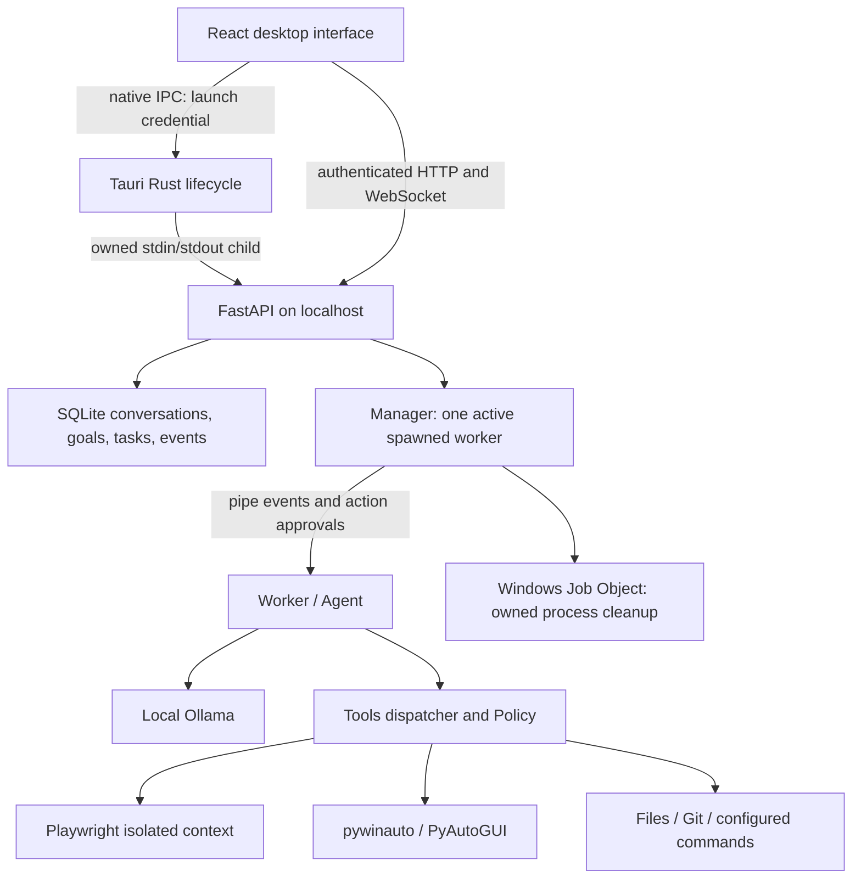

# Architecture Review

Native capture/preview gap resolved (2026-10-27): owner confirms the installed preview;
two new JPEG capture records independently verify format/dimensions/size/hash. Images are
unbound; no model-image analysis is inferred. Raw screen content is not exported and the
private read-only database copy is removed. No source changes; P0-05 third still needs
clean-install/upgrade/history/uninstall testing. See
.runtime/p0-05-native-capture-acceptance/validation.json.

Native independent-Ollama ownership verified (2026-10-27): owner installed run confirms
connection and X close; the same separately owned model process/listener/health survives
that close before the harness cleans its fixture. Tested operator source and installed
hashes match; fresh inspection confirms owned cleanup. This closes the normal-close native
preservation gap without application changes. Capture/preview and clean-install/upgrade/data
acceptance remain. See .runtime/p0-05-native-shared-model-acceptance/validation.json.

Independent-Ollama native test support (2026-10-27): existing service reuse/ownership code
is retained. A separate operator composes existing process jobs, package identity and native
observations with a fixed, bounded loopback health request. No application API/tool surface
or inference settings change.17 new contracts and60 combined checks pass, zero skips; Ruff
passes. Existing native window is safely preserved, so actual shared-service acceptance
remains unverified. Capture and clean-install/upgrade remain open. See
docs/native-shared-model-check.md and IMPLEMENTATION.md.

Native export delivery (2026-10-27): owner-triggered download is independently verified
on disk in Downloads,208 UTF-8 bytes matching the official complete two-message export
from a read-only state snapshot. Attachment body is excluded; no Save As dialog is inferred.
This closes the export/download validation gap without source changes. Capture/preview,
shared-Ollama preservation and install/upgrade/data behavior remain. See
.runtime/p0-05-native-export-acceptance/validation.json and IMPLEMENTATION.md.

Native text-attachment acceptance (2026-10-27): owner confirms Windows picker operation;
independent stored sanitized text/hash, message binding and matching real-model reply/native
token counters corroborate the flow. Text intentionally has no separate raw byte blob.
This closes that third-increment subcheck without application changes. Native export,
capture/preview, shared-Ollama preservation and install/upgrade/data behavior remain open.
See .runtime/p0-05-native-attachment-acceptance/validation.json and IMPLEMENTATION.md.

P0-05 first closed (2026-10-27): installed owner run and independent report/process checks
verify retry exhaustion with1.09/2.02/4.05-second gap lower bounds, manual restart/connection,
owned normal-close cleanup and independent Python preservation. Earlier native focus,
interruption/no-replay/fresh review and component/frozen fault checks complete the first
lifecycle increment. No architecture change was required. Physical controls, native shared-
Ollama preservation and tested installation/upgrade remain third-increment gaps. Build input
audit retains one cosmetic patches.py EOF difference with identical AST; installed hashes
match. See .runtime/p0-05-native-lifecycle-acceptance/validation.json and IMPLEMENTATION.md.

Native retry/fallback test support (2026-10-27): an operator-only script reuses owned-process
jobs and safe path checks, verifies installed hashes, induces a loopback port collision
before backend initialization, measures root backend attempts, and requires owner fallback/
connection/close observations. No product IPC, tool registry or recovery behavior changes.
Twelve new contracts plus combined43/43 checks pass; rendered recovery1/1 passes. Existing
Studio is preserved; actual native exercise remains pending. See docs/native-recovery-check.md.

Fresh native approval after crash (2026-10-26): independent evidence confirms a distinct
resubmitted task requests a new approval and records denial. Original interrupted/unknown
intent is unchanged and the file remains absent. Real model calls resume; pre-request
history identities persist. This verifies this specific recovery/approval scenario, not
retry-budget exhaustion/manual fallback or all active effects. No source change was needed.
See .runtime/p0-05-native-recovery-fresh-denial/ and IMPLEMENTATION.md.

Pending-approval native crash (2026-10-26): independent before/after evidence confirms
waiting-to-interrupted transition, absent unapproved file, old worker cleanup, fresh owned
services and no new task/operation/verifier or approval-resolution records. The unfinished
write remains unknown, consistent with conservative journal recovery. This verifies the
specific interruption/no-replay path, not rollback or all active-work effects. Fresh
resubmission approval and native retry/fallback timing remain open. See
.runtime/p0-05-native-pending-crash/validation.json and IMPLEMENTATION.md.

Idle native crash recovery (2026-10-26): after owner ends the identified idle backend,
the same native instance owns new backend/model processes and one listener per service;
old children are gone. Prior history identities persist with no new task/operation records.
Owner observes automatic reconnection. This corroborates the idle path, not active-work
interruption, native retry-budget timing/exhaustion or post-crash generation. See
.runtime/p0-05-native-idle-crash-recovery/ and IMPLEMENTATION.md.

Normal reopen update (2026-10-26): owner-visible generation is corroborated by a new
native/backend/owned-model process chain and a reported Chat task with native token counters.
All pre-close history identity sets remain. Exact-response compliance did not pass; the
model's reset wording does not describe an observed application reset. Normal reopening
does not verify backend crash recovery or upgrade. See .runtime/p0-05-native-reopen/.

Installed normal-close update (2026-10-26): owner-initiated idle close is independently
corroborated by disappearance of all four recorded native/backend/owned-model PIDs and
release of both listeners. No observer kills or service restarts. Duration and unrelated-
process preservation were not established by this run; crash/active-work cleanup and
upgrade remain separate. See .runtime/p0-05-native-normal-shutdown/ and IMPLEMENTATION.md.

Installed second-launch update (2026-10-26): owner observes existing-window focus, consistent
with the registered single-instance plugin. Post-launch inspection retains the original
native/PyInstaller-pair/Ollama PIDs and one backend listener; no persistent duplicate exists.
This snapshot does not establish a continuous transient-process trace. Shutdown/recovery
and upgrade acceptance remain separate. See IMPLEMENTATION.md and
.runtime/p0-05-native-second-instance/observation.json.

## P0-05 installed native approval evidence (2026-10-26)

Owner exercised Agent file-creation denial followed by approval on a fresh task. Independent
read-only installed-state inspection confirms distinct false/true decisions, denied/observed
journal outcomes and zero/one artifact records. The validated passed record agrees with an
independent exact18-byte file readback/hash. Native dialog operation remains owner-observed;
this verifies the specific approval path without proving second-instance, recovery, shutdown
or upgrade/history behavior. No architecture or application change was needed. See
IMPLEMENTATION.md and .runtime/p0-05-native-approval-verified/installed-observation.json.

## P0-05 installed hash semantics and native progress (2026-10-26)

Actual installed recovery verifies automatic owned Ollama startup, reported chat/native
counters, retained configuration and real installed-backend browser/memory workflows.
The owner confirms visible reply/Copy/Stop. Full physical/native recovery and upgrade
acceptance still remain. The installed native EXE differs from the restored build copy
only by Tauri's3-byte NSIS tag. Release metadata now preserves raw hashes and separately
predicts the unsigned default NSIS payload, with unavailable results for signed/unknown/
ambiguous inputs and no prediction on partial builds.9 release/discovery tests and actual
installed hash comparison pass. This metadata-only change neither patches binaries nor
claims installation/signature certification. See IMPLEMENTATION.md and docs/desktop.md.

## Installed portable Ollama bootstrap correction (2026-10-26)

An actual installed-app failure revealed that development-only base-relative discovery and
PATH omit an existing portable runtime in another directory. ollama_runtime now resolves
trusted executable/models config and standard Windows installs, retaining local portable,
environment and shared-service semantics. Launch validates loopback-only binding and excludes
the Studio credential. A host-invoked config helper preserves existing bytes/settings with a
backup and DACL-preserving replacement; it is not exposed through tools or privileged APIs.
850 default tests775 passed/75 skipped,32 focused and7 fresh frozen checks pass; updated
NSIS builds. Real owned Ollama startup/readiness/cleanup is verified, but model-store access
is denied in the managed context. Normal-session configuration/inference/native acceptance
remains required. This fixes a reproduced bootstrap gap without treating service readiness
or an installer build as complete native acceptance. See docs/desktop.md.

## P0-05 packaging recovery: owner-built NSIS artifact (2026-10-26)

The owner-session build now produces the real NSIS installer and a successful dependency/
source manifest.115 inputs and3 artifact hashes match;61 frozen modules compare equal
to current source, and deployed sidecar/resource copies match reviewed inputs. New frozen
runtime/socket/live-browser/coding checks17/17, frozen MCP1/1 and Rust7/7 pass, no skips.
P0-05's second packaging increment closes. Native rendering/single-instance/recovery and
standard-user installation/upgrade remain separate unverified gates. Existing managed
network/GPU denials are context-specific historical evidence, not proof this installer
cannot run. No application rewrite, lock overwrite or security change was required.

## P1-03 B3: integrated text-memory qualification (2026-10-26)

The unchanged production MemorySources/MemoryIndex paths qualify against the immutable
32-fact corpus through16 explicitly imported paired-chunk files,64 scoped distractors and
32 matching other-project notes. After Manager restart, literal hybrid32/32 and paraphrase
hybrid30/32 versus lexical14/32 meet the predeclared gates; cross-project results are zero.
The two historical misses remain. One actual-model run also verifies parent citation/source
hash/spans, source-change history/vector exclusion, whole-source forget and chat cascade.
89 focused tests83 passed/6 skipped and Ruff pass; B2a/B2b's unchanged actual frozen and
rendered artifacts supply integration/package evidence. P1-03 B closes at explicit bounded
text-memory scope. No vector server, cloud fallback, autonomous memory crawler, execution
authority or universal semantic quality is implied. Native/installer acceptance stays open.

## P1-03 B2b: reviewed file-memory controls (2026-10-26)

FileMemoryControls integrates existing B2a routes within MemoryPanel. The existing root
chooser plus an exact project-relative path limits selection; preview shows normalized
excerpts/spans and raw hash/resource version before confirmation. Reimport is always freshly
reviewed. Source state is labelled saved metadata until checked; whole-source forget preserves
originals. Generation guards discard late responses across project/connection/version changes,
and conversation changes dismiss pending reviews. Scoped operation state keeps other memory
mutations disabled while the global stop remains available after confirmation.

Source/frozen rendered positive/conflict/cancel/navigation/blank-conversation/900px acceptance
passes.76 focused tests72 passed/4 skipped;23 frontend tests, Ruff and TS/Vite runner build
pass. Backend source/package remains B2a's verified artifact. Native IPC/rendering is still
separate, and combined retrieval qualification remains B3. See the project-memory guide.

## P1-03 B2a: explicit file-source backend (2026-10-26)

Schema10 adds scoped source/chunk provenance to existing notes and vectors. MemorySources
reuses Coding.read, Policy and fingerprints, with bounded preview/confirmed transactional
import, raw-byte/resource identity and a documented BOM/newline-normalized chunk view.
Sources are explicit, limited and credential-checked before splitting; originals are never
written. Fresh host-owned receipts connect file preflight outside the cancellation lock to
memory/index/task admission. Metadata/layout/hash changes refuse stale publication/context.
Changed/missing/unsafe sources lose vectors and advance history exclusion epochs; retained
stale snapshots are human-readable only. Active-task reads label saved-only freshness and
cannot become context receipts. Whole-source forgetting/chat deletion cascade derived rows.

836 default tests:765 passed/71 skipped. Actual source and frozen embedding/chat workflows,
rendered source/frozen provenance, semantic/backup and approved coding checks pass. The
additional rendered restore test is blocked by the user's Vite1420 listener; populated
storage backup/restore passes.73-module wheel and61-module frozen source equality pass.
B2a closes; chooser/review UI B2b and combined qualification B3 remain open. Observed file
freshness is point-in-time, not OS isolation or current artifact verification. See
docs/project-memory.md and .runtime/p1-03-memory-sources/validation.json.

## Native diagnostic boundary (2026-10-26)

Development startup diagnostics now cover a blank native window before React/backend
readiness. The bounded owner-run helper uses a private profile and harmless loopback
page; it exports categories instead of log bodies, protects raw-log removal and reaps
only its owned process tree. It has no agent registration or privileged HTTP endpoint.
Native GPU subprocess access denial0xc0000022/unusable GPU is observed in this managed
context; the precise denied operation remains unknown. A requested page/valid diagnostic
report does not establish application readiness, native recovery or installer acceptance.
Default692 passed/65 skipped;13 focused including actual diagnostic pass; Ruff/lock and
wheel/source/import pass.66 prior runtime modules are unchanged. See docs/native-diagnostics.md.

## Current extension boundary: P2-02 verified (2026-10-26)

The optional `mcp_project_read` adapter now uses pinned official SDK2.3.0 and one
shipped version1 read-only stdio server. It retains immutable ToolSpec/profile dispatch,
Policy scope/redaction/audit, journal observations and task cancellation. Catalog and
identity drift fail for trusted review. Bounded custom pipe framing wraps SDK sessions;
Windows suspended spawn establishes Job ownership before server execution. No arbitrary
server command/URL, remote transport, delegated permission or mutation was added.

Default680 passed/64 skipped; real local-model task, frozen MCP, frozen coding regression
and isolated packaged-wheel read pass separately. Dependency lock/sync and Ruff pass.
The lock is for the existing Windows/Python3.12 runtime; exact SDK-wheel metadata supports
offline resolution. Other targets and installed native-app acceptance remain unverified.
See docs/mcp.md and .runtime/p2-02-mcp-integration/validation.json. Earlier statements
that MCP was absent describe the historical audit, superseded for this first increment.

Audit date: 2026-10-22. Scope: the current Windows checkout, not a proposed rewrite.
Companion documents: [feature assessment](FEATURE_GAP_ANALYSIS.md) and
[prioritized acceptance checklist](ROADMAP.md).

## Assessment

Local Agent Studio is a working local chat application and bounded, approval-gated tool
executor. Real Ollama inference, GPU allocation, native tool calls, vision, local browser
automation, file operations, and process-based Studio workflows passed this audit's tests.
It is not yet a durable autonomous execution platform or an operating-system sandbox.

Keep the current Tauri/React/FastAPI/Ollama/SQLite architecture. Its small synchronous
agent and deterministic adapters are useful foundations. Fix lifecycle, approval-state,
event-delivery, and validation gaps before adding more autonomous executors.

## Audit method and scope

Read AGENTS.md and IMPLEMENTATION.md, all first-party Python application modules and
tests, React/TypeScript/CSS source, Rust entry/build source, PowerShell/Python scripts,
configuration/manifests, README, and supporting architecture/usage/performance documents.
Reviewed lockfile/dependency metadata and existing executable/build artifacts. Dependency
implementations, generated bundles, model weights, and private conversation contents are
outside the source audit. Searched the application for MCP, embeddings, scheduling,
checkpointing, delegation, backup, and resume implementations, then inspected the actual
dispatcher, schema, and execution paths rather than treating search absence as proof alone.

Only the three requested review documents were added. No application functionality,
configuration, dependencies, or existing documentation was changed. Verification generated
temporary test/build artifacts. Source/configuration/lockfile hashes were recorded in
`.runtime/architecture-review/source-hashes.json` for a final unchanged-source check.

The checkout now has `.git` metadata but no commits; application files are untracked.
Older statements that Git metadata, API packages, or Node/Rust are absent are historical.

## Current system and reusable boundaries

| Boundary | Existing code to retain | Important limit |
| --- | --- | --- |
| Reasoning | `local_agent/agent.py`: structured plan, sequential native tools, bounded steps/failures, observations | Plan is a list of prose steps; the loop does not persist step execution or independently certify completion. |
| Inference | `model.py`: loopback transport, no proxy/redirect, streaming and authoritative usage | One selected model per task; no capability-aware routing, tokenizer, or structured truncation handling. |
| Tools | `tools.py`: 19 registered functions, argument validation, audited dispatch | Static map and signature-derived schemas; no plugin interface or per-task category permissions. |
| Policy | `safety.py`: scoped paths/origins, default-deny approval, STOP latch, redaction | Logical application checks; approved code and desktop input retain Windows user privileges. |
| Automation | `browser.py`, `desktop.py`, `coding.py`, `process.py` | Real adapters; browser contexts are temporary, desktop focus is shared, commands return bounded output after completion. |
| Supervision | `cli.py`, `windows_job.py`, `studio/manager.py`, `worker.py`, `runtime.py` | Owned task cancellation works; arbitrary startup/monitor/storage failures are not fully reconciled. |
| Persistence | `studio/store.py`, `attachments.py`, `commands.py` | SQLite WAL, migrations, conversations, goals, attachment ownership; history is not a checkpoint or semantic memory. |
| Presentation | `desktop/src/App.tsx`, `CommandUI.tsx`, `api.ts`, `styles.css` | Useful integrated workflows; large shared component, loosely typed events, global activity/preview state. |
| Packaging | `desktop/src-tauri/src/main.rs`, Tauri capabilities/configuration, build/setup scripts | Debug executable exists; no release sidecar or NSIS artifact found. Installed-app acceptance remains open. |

## Verification performed in this audit

Environment: Python 3.12.14; Node 24.22.1; Rust/Cargo 1.99.1; RTX 4070 Ti,
12,282 MiB, driver 616.56; Ollama 0.40.7. Installed packages include Playwright 1.64.0,
pywinauto 0.6.9, PyAutoGUI 0.9.54, Pillow 12.3.0, FastAPI 0.159.1, Uvicorn 0.54.0,
httpx 0.28.1, psutil 7.2.2, PyInstaller 6.22.3, and Ruff 0.17.1. Availability is not a
dependency vulnerability assessment or proof of packaged compatibility.

| Check | Observed result | What it establishes |
| --- | --- | --- |
| `.venv\Scripts\python.exe -m unittest discover -s tests -t . -v` | 107 executions in 19.700s: 91 passed, 16 skipped | Default regression, API authentication/scopes, persistence, real fixture workers/processes, approvals, deterministic coding cycle. |
| Explicit live Studio, attachment, model, browser classes | 12 tests in 29.546s: 11 passed, one error | Real contextual streaming/cancellation/read tools, image/text attachments, structured output/GPU, tool write/readback, vision, local navigation/form/tabs/download/screenshot, denied POST, model-driven browser/file coordination. |
| Live public-site test | `ERR_NAME_NOT_RESOLVED` at `https://example.com/` | Current external DNS blocker; the later public form check was not reached. |
| `LIVE_STUDIO_UI=1` with `python -m unittest tests.test_slash_ui -v` | One composite scenario passed in 22.102s | Real React/FastAPI/WebSocket/SQLite/worker/Ollama flow: commands, goals, plan regeneration, approved tests/diff, cancellation races, attachment/chat management. |
| Ruff and TypeScript `tsc --noEmit -p desktop/tsconfig.json` | Passed | Python lint and frontend static typing. |
| Vite production build, `--configLoader runner` | Passed; audit output under `.runtime/architecture-review/frontend` | Current frontend builds; asset hashes match existing `desktop/dist`. Does not certify default config loading or the installer pipeline. |
| `cargo check --locked --offline` with development bundle override | Passed in 36.28s | Rust source/type/build-script check using cached dependencies. No release link, install, or native lifecycle acceptance implied. |
| Artifact inspection | `target/debug/local-agent-studio.exe` exists; no release sidecar/NSIS EXE | A compiled debug app exists. An installer is not delivered by the inspected checkout. |

Live GPU evidence: `qwen3.5:9b`, Q4_K_M, context 8192, `size_vram=5862210928` bytes,
equal to the model's reported allocation. This establishes GPU residency for these calls,
not general task reliability. The initially idle service was reused; no unrelated process
was terminated and no persistent inference settings were changed.

The browser UI harness bridges **only native connection IPC**, but it is still a browser
harness: physical clipboard, native picker/export behavior, main-screen capture, Tauri
startup/restart/single-instance/shutdown, and frozen multiprocessing remain unverified here.
Interactive Notepad was deliberately not run during this audit because that opt-in test
moves focus and types on the user's desktop. Historical desktop failures are not a new
failure result; the capability remains implemented but not accepted.

Test accounting matters: 107 discovered executions represent 88 distinct test-method
implementations. There are 19 repeated executions caused by imported test classes and
inherited tests. Some inherited reruns exercise a different fixture; counts are not 107
independent capabilities. Default skips include nine original live checks, three Studio
live checks, one attachment live check, two UI scenarios, and a Windows symlink check.
This audit separately enabled all of those live categories except physical desktop; the
symlink check remains skipped. There is no measured code-coverage gate.

## Reliability and security findings

Severity below reflects impact under the stated conditions; it is not a claim of a
remotely exploitable unauthenticated service.

| ID | Finding and evidence | Consequence / recommended response |
| --- | --- | --- |
| R1 | **Reproduced:** `Manager.start()` commits a task/message before `proc.start()` (`manager.py:92-99`); injected spawn failure leaves `running` in SQLite with no worker. | UI can stay working until recovery. Make startup transactional/compensated and guarantee terminal reconciliation. P0-02. |
| R2 | **Source-confirmed:** monitor marks `done` before separate finish/message/event commits (`manager.py:144-149`); exceptions are not reconciled. No worker heartbeat/whole-task deadline. | Disk/pipe errors or a living but hung adapter can leave inconsistent state or indefinite work. Add fault handling and bounded deadlines without counting approval waits as hangs. P0-02. |
| R3 | **Reproduced query limit; delivery gap follows from source:** `Store.events()` returns 1,000 rows; `/events` fetches one page then starts at the latest RAM cursor. RAM holds 4,000 events (`store.py:228-231`, `api.py` WebSocket route). | A reconnect can omit persisted events beyond the first page. Add stable paginated replay, deduplication, and explicit gap handling. P0-02. |
| R4 | **Source-confirmed conditional race:** overwrites review old content but do not compare its digest after approval; Git commit does not recheck the reviewed index; download checks destination before approval then calls `save_as` (`coding.py:47-67,126-138`, `browser.py:87-97`). | Concurrent changes can invalidate what the user reviewed. Bind approval to resource versions; use exclusive/atomic writes and fail closed on changed state. P0-03. |
| R5 | **Reproduced synthetic canary:** separately cleaning chunks `password=` and `AUDIT_CANARY` displays the joined secret unchanged (`worker.py` emit, `agent.py` clean). Final stored text is separately redacted. | Chunk-local redaction cannot promise safe live output. Bound streaming buffering/redaction, test chunk boundaries, and state residual limitations. P0-04. |
| R6 | **Source-confirmed:** a tool screenshot removes `images` from every earlier message (`agent.py:111-113`), including user attachments. | Multi-image tasks can silently lose the original visual input after an observation. Separate attachment and transient-observation lifetimes. P0-04. |
| R7 | **Known boundary:** process Job Objects terminate owned descendants; path checks do not constrain arbitrary Python, Git filters/signing programs, Save As dialogs, or shared desktop focus. | Trusted-code approval is not OS isolation. Review local Git execution surfaces and strengthen change validation; add an optional VM execution boundary before supporting hostile code. P0-03, P1-07. |
| R8 | **Source-confirmed:** `Agent.run()` can return `reported` after failed/nonzero tool evidence when the model stops. Goal checkmarks are explicitly user-reported. | An independent task verifier is missing. Preserve honest `reported` status; introduce separate verified/failed/unverified outcomes. P1-02. |
| R9 | **Source-confirmed:** character heuristics approximate context; planning happens before the loop's budget check; schemas, output reserve, and vision costs are not fully budgeted. | Long multilingual/code/vision tasks can truncate or fail despite an accepted request. Add model-aware admission, bounded compaction, and explicit truncation reporting. P1-05. |
| R10 | **Source-confirmed:** native backend/model stderr is discarded; WebSocket retry cannot respawn a crashed backend; Rust exposes a manual restart. | Failure diagnostics and recovery are incomplete, not wholly absent. Add redacted bounded diagnostics and bounded backend restart; never replay tasks automatically. P0-05. |

Subsequent implementation (2026-10-22): P0-02's first and second increments address R1
and R2 with startup compensation, atomic terminal reconciliation, owned-resource cleanup,
readiness/heartbeat/phase/task deadlines and explicit approval waits. Current tests/evidence
are in IMPLEMENTATION.md; the table preserves the original audit findings. P0-02's third
increment now addresses R3 with captured-boundary replay, acknowledged bounded delivery,
UI deduplication and explicit RAM-gap reconciliation. Real SQLite/socket tests and rendered
UI acceptance preserve all 5,001 events once across reconnect and backend restart. Tokens
and sensitive preview/approval bodies retain their transient treatment. Native delivery,
OS isolation, checkpoint resume and the other findings remain separate work.

P0-03 update (2026-10-22): R4 is addressed by reviewed file/index/HEAD versions,
checked atomic writes and exclusive download publication. Actual Windows DACL/junction,
Git-helper, browser and model/UI/coding checks pass. Git helper/include restrictions also
reduce R7's execution surface; they do not supply OS isolation or close same-user races.
See the separately dated first/second increment evidence in IMPLEMENTATION.md.

P0-04 first-increment update (2026-10-22): R5's supported textual chunk-boundary leak is
addressed by a bounded shared parser before worker token emission. Every split/cancellation,
long-value/state-bound and actual live/SQLite canary checks pass. Unknown text formats and
pixels remain best effort; R6's original-image retention is the next increment.

Existing strengths include ephemeral native launch credentials, loopback binding,
HTTP bearer and WebSocket origin/token checks, no general shell API, narrow command
profiles, secret-path/hardlink checks, approval replay rejection, environment filtering,
isolated browser contexts, blocked service workers/WebSockets, and cancellation ownership.
Tests validate several of these boundaries. Prompt-injection role tagging is useful but
not a security proof. Allowed GET requests can have side effects. A same-user malicious
process, approved arbitrary repository code, and desktop focus races exceed the current
threat boundary. SQLite contains sensitive local content without application encryption;
logical deletion is not secure erasure. The content-free audit file is not tamper-evident.

## Recommended evolution

Keep one deployment and one policy-controlled execution path. Introduce the following
interfaces incrementally; names describe responsibilities, not a required new framework.

1. **Run coordinator:** evolve `Manager`, keeping process/Job Object ownership. Add atomic
   transitions, startup compensation, deadlines, durable event cursors, and resource leases.
   Serialize desktop input and local GPU work; do not introduce parallel workers first.
2. **Tool registry:** replace only the static registration metadata with versioned typed
   specifications: argument/result schemas, permission category, side-effect class,
   timeout, and verifier. Adapt existing methods unchanged behind it. Modes should become
   explicit permission profiles rather than merely workspace labels.
3. **Verification layer:** retain `Agent` planning/execution, but persist named step IDs,
   tool evidence, artifact hashes, and verifier results. Model prose cannot mark a step
   independently verified. Start with test exit/readback checks before open-ended recovery.
4. **State and memory services:** keep SQLite. Introduce numbered migrations, transactional
   run/event updates, backup/restore, and optional scoped memory records with provenance.
   Add keyword retrieval first, then local embeddings only after retrieval evaluation.
5. **Model service:** keep the existing transport, centralize generation options and
   capability checks, and record prompt/load/generation timing. Add measured per-task
   routing later; keep explicit user model choice and no cloud fallback.
6. **UI modules:** extract chat, approvals, task activity, workspace, and models from App.tsx
   behind typed API/event contracts. Add task-scoped previews/history and accessible
   dialogs while preserving the existing UI acceptance suite.

For durable work, persist `runs`, `steps`, `tool_calls`, `verification_results`,
`approval_decisions` (minimal hashes/expiry, not secret bodies), and versioned events.
Capture intent before execution and observed results afterward. A crash between a side
effect and its journal commit means **unknown outcome**, not safe automatic replay.
Read-only/idempotent steps can eventually resume after precondition checks; external
submissions, arbitrary commands, and desktop actions require reconciliation and renewed
approval. Browser/desktop handles are not serializable checkpoints. Keep pause disabled
until the supported subset passes restart tests. SQLite transactions alone cannot provide
exactly-once effects in browsers, files, or other applications.

## Framework and dependency decisions

| Decision | Reason and evidence |
| --- | --- |
| Retain direct Playwright | Real local tests pass; existing method/network approvals stay centralized. Official [network controls](https://playwright.dev/python/docs/network) support this design. Broader web compatibility needs targeted origin/auth tests. |
| Retain pywinauto with PyAutoGUI fallback | [pywinauto documents Win32/UIA backends](https://pywinauto.readthedocs.io/en/latest/getting_started.html); [PyAutoGUI](https://pyautogui.readthedocs.io/en/latest/) supplies input/screenshot primitives. Physical Windows acceptance remains necessary. |
| Do not add Browser Use or Aider now | Browser Use has an official [Ollama example](https://github.com/browser-use/browser-use/blob/main/examples/models/ollama.py); Aider documents [Ollama integration](https://aider.chat/docs/llms/ollama.html). Neither is integrated here. A second editing/action loop would need the same policy, cancellation, and verification controls; no demonstrated gap requires that rewrite. |
| Keep SQLite | Existing WAL and ownership tests work. Use the [online backup mechanism](https://www.sqlite.org/backup.html) for consistent snapshots; do not copy an active WAL database file alone. No Redis/vector server is initially needed. |
| Add local embeddings only when useful | Ollama's documented [`/api/embed`](https://docs.ollama.com/api/embed) provides vectors; the chat model is not automatically an embedding model. An explicit local embedding dependency and provenance/deletion tests are required. |
| Add MCP as a policy adapter later | The official [MCP architecture](https://modelcontextprotocol.io/docs/2026-07-28/learn/architecture) distinguishes host/client/server and transport. MCP is a protocol, not a permission sandbox. Pin a compatible SDK/protocol and begin with an explicitly configured read-only local server. |
| Keep Job Objects; add stronger isolation separately | Microsoft documents [Job Objects](https://learn.microsoft.com/en-us/windows/win32/procthread/job-objects) as process management. A [Windows Sandbox/VM](https://learn.microsoft.com/en-us/windows/security/application-security/application-isolation/windows-sandbox/) can offer a stronger boundary, subject to Windows edition/virtualization and approved setup. No host setting should be silently enabled. |
| Validate installed Windows packaging | Follow [Tauri's installer guide](https://v2.tauri.app/distribute/windows-installer/). Current Rust checks and debug artifact do not validate PyInstaller workers, external Python, browser discovery, first-run configuration, or upgrade behavior. |

Inference options and timing fields should follow [Ollama chat documentation](https://docs.ollama.com/api/chat).
Residency/cache tuning should follow the [Ollama FAQ](https://docs.ollama.com/faq) and local
measurements. Historical benchmark artifacts suggest useful warm-start benefits, but broad
agent quality, alternative models, and Flash Attention/cache comparisons remain unproven.

## Avoidable duplication and scope

- Imported/inherited test classes inflate discovery; move reusable fixtures into support
  classes that unittest does not discover, while retaining intentional parameterized runs.
- `agent.toml`, the packaged example, launch scripts, and model helpers duplicate defaults.
  Keep a trusted configuration schema and test default parity; preserve intentional
  production differences such as the absent `serve` profile.
- Chat/non-stream/benchmark payload construction repeats inference options; centralize the
  production request policy without forcing benchmark-specific limits into normal tasks.
- README and older IMPLEMENTATION sections contradict newer verified evidence. Add a
  dated current acceptance summary later rather than another disconnected checklist.
- The CLI and GUI share actual adapters; they are useful entry points, not redundant
  implementations. Workspace tabs share an executor intentionally; do not create separate
  autonomous stacks merely to match navigation labels.
- Retain local single-user scope. Distributed orchestration, cloud inference, unrestricted
  plugins, and an agent marketplace have no evidence-backed need in this repository.

### P0-04 image-context verification update (2026-10-22)

R6 / F03: original image eviction is fixed. Agent retains user images and only evicts
prior transient observations; total image count is eight, each new observation is at
most 1600 pixels per side / 2 MiB. Owned capture registry/leases support safe preview,
consumption, cancellation and abandoned-run cleanup without deleting chat attachments
or unregistered files. Twenty targeted lifecycle/image/startup checks and two actual
Ollama + Edge tests pass, including spawned Studio preview/attachment preservation.
See IMPLEMENTATION.md for complete regression evidence and initial service failure.
These checks do not establish physical desktop capture, native packaging, pixel-secret
redaction or OS isolation. Unknown/replaced owned paths deliberately block cleanup.

### P0-05 packaging evidence update (2026-10-22)

The actual PyInstaller sidecar and optimized Windows release now build. Final frozen
acceptance passes 15 runtime, authenticated socket, approved external-Python and actual
Ollama/Edge browser/screenshot tests. Exclusive first-run configuration publication has
three native tests; seven Rust tests pass overall. Default regression: 197 passed /
26 skipped. Artifact checksums and 47 source/lock input hashes were independently checked
against `dist/release-manifest.json`. This closes frozen-path validation gaps at that scope.

Native single-instance/crash acceptance remains open after WebView2 resource-in-use;
NSIS bundling is externally blocked by socket error 10013 downloading the official tools.
No installer, clean install or upgrade pass is claimed. P0-05 stays unchecked; the next
independent increment is P1-01, depending on completed P0-03. See IMPLEMENTATION.md and
docs/desktop.md for commands, exact evidence and blocker-resolution steps.

### P1-01 contract verification update (2026-10-23)

Versioned built-in ToolSpec records and per-run Unified/Coding/Browser/Desktop profiles
are implemented. Registry/profile metadata is immutable; schema/type/default/command
validation precedes adapter dispatch. The CLI, authenticated task/slash API and rendered
UI preserve the profile, including original-profile regeneration and legacy task migration.
All 19 final model-facing schemas match the saved pre-increment implementation exactly.
Fourteen targeted cases, four real UI/approved-test/local-browser checks and final default
regression (211 passed / 27 skipped) pass; TypeScript/Vite, Node and Ruff pass.

This verifies the registry/profile contract in F07. MCP/provider integration remains open.
Live model regression is currently blocked: the managed Ollama service cannot open its
Qwen manifest. Tests were attempted and failed, not counted as passes; historical 2026-10-22
model evidence is not described as current. Native/NSIS blockers also remain. See the latest
IMPLEMENTATION.md entry and docs/tool-profiles.md for exact evidence and resolution steps.
Next: P1-02's first configured-test verifier, using the tested registry/worker boundary.

### P1-02 first verifier evidence update (2026-10-23)

F04 now has separately persisted configured-unittest observations: TestResult counts,
exit code, canonical status and command hash. Structured counts distinguish nonzero passes,
zero discovery, skips, expected failures and unsupported/missing results. Model/console
prose cannot create records. Exact execution still requires approval; changed reviewed
helpers are rejected. Fresh bytecode-cache scope prevents same-tick stale imports.

Evidence/event persistence is atomic and idempotent; API retrieval is authenticated;
records survive interruption and are removed with conversations. UI describes an observed
run, separately from reported task prose. Eighteen verifier checks pass; default regression
229 passed / 27 skipped; actual rendered approval/test/evidence UI and five rebuilt frozen
backend checks pass. See IMPLEMENTATION.md and docs/test-verification.md for exact limits.

P1-02 A remains open for artifact readback/hash and current real-model counter acceptance.
The helper is trusted-host execution, not hostile-code attestation or an OS sandbox. A hard
crash can leave small helper/count metadata. Existing model/native/NSIS blockers remain;
no skipped/blocked gate is counted as passed. Next: the artifact verifier within A.

### P1-02 artifact evidence update (2026-10-23)

Coding writes and literal no-ops now have bounded exact-byte/SHA-256 readback observations.
Strict path/link and reviewed-resource checks remain; changed or missing publications are
recorded without retry/repair. Parent validation independently determines the verdict.
Metadata and resource-version digests persist via the existing verifier transaction/API,
without raw file contents or errors. UI distinguishes artifact readback from test results.
The previous newline-normalized no-op comparison was fixed so CRLF/LF changes are reviewed.

Thirteen artifact and eighteen test-verifier cases pass; default 242 passed / 28 skipped;
two rendered scenarios and three rebuilt frozen-backend/UI checks pass. TS/Vite/Node and
Ruff pass. P1-02 A's initial components are implemented; full A stays open for current
model-driven counter acceptance. Live model/native/NSIS blockers remain unpassed. This is
point-in-time byte evidence, not semantic task correctness or future-state authorization.
Next independent work: scoped repository search within P1-02 B. See IMPLEMENTATION.md and
docs/artifact-verification.md for exact evidence and limits.

### P1-02 scoped search update (2026-10-23)

The existing Coding/Policy stack now provides bounded literal UTF-8 repository search.
The same adapter serves the twentieth tool and authenticated Workspace search, avoiding
a separate shell/search-service dependency. Existing 19 schemas are unchanged. Windows
path lstat supplies identity/link metadata instead of incomplete DirEntry cached fields.
Search guards read stability, excludes credential/control/state/link inputs, redacts before
preview clipping, and reports coverage limits rather than claiming complete absence.

Seventeen search and fourteen tool-contract cases, three rendered UI scenarios and seven
rebuilt frozen-backend/UI/runtime checks pass. Default: 259 passed / 29 skipped; TS/Vite,
Node and Ruff pass. Scope/deadline/OS-isolation limitations are in docs/repository-search.md.
Model port 11434 currently has no listener; no new model-quality pass is inferred. Reviewed
patch sets, streamed command output and background readiness remain missing within B.

### P1-02 related-file review update (2026-10-23)

Coding/Unified now exposes apply_patch with an explicit bounded object-array contract.
The original 20 schemas are preserved. Proposed raw-byte hashes, whole-set version checks
and one reviewed diff set extend existing single-file publication; no Git patch parser,
shell endpoint or framework added. read_file adds a stable original-byte hash while keeping
its existing newline-normalized text view. Per-file artifact observations reuse existing
worker/store/UI paths. Incomplete outcomes block continuation and expose uncertainty.

Seventeen new patch tests and 91 targeted regressions pass; default 276 passed / 30 skipped;
four rendered scenarios and eight rebuilt frozen/backend/runtime checks pass. TS/Vite/Node/
Ruff pass. Publication is sequential and not crash-atomic; no rollback, deletion/rename or
durable patch journal is claimed. See docs/patch-sets.md and IMPLEMENTATION.md. Current
model/native/install gates remain open. Next: bounded command streaming, then readiness.

### P1-02 foreground output update (2026-10-23)

Foreground run_process now drains merged pipes into a bounded redacted prefix; configured
commands and test-verifier execution expose a host-only sink. At most 64 ordered deltas
use existing durable events/replay, without a new endpoint or tool schema. Manager validates
per-command identity/sequence/profile/byte limits. The scoped latest-three panel folds events
without replaying execution and distinguishes unknown interruption from observed exit.
Nested Windows jobs close owned descendants inheriting stdout; output is not a disk spool.

Internal Git config/path parsing explicitly retains bounded original text; redaction there
could hide policy keys or weaken versions. Raw parsing cannot attach an output sink and
is not model-configurable. Fifteen stream cases and all 83 targeted checks pass; final
default 291 passed / 32 skipped; six rendered scenarios and ten rebuilt frozen-backend/UI/
runtime checks, TS/Vite/ten Node/Ruff pass. Known-pattern, prefix, retention and Windows-only
subtree limits are in docs/command-streaming.md. Background output/readiness remains next;
current model/native/install gates remain open.

### P1-02 owned background readiness update (2026-10-23)

BackgroundCommand now owns bounded output, monitor/reader/Windows Job resources and optional
configured readiness; foreground/background share OutputPublisher instead of duplicating its
limits. command_status adds an owned-profile-only inspection contract. All preceding 21
schemas are unchanged. Readiness requires literal loopback HTTP and listener-tree ownership,
with exact configured status, no redirect/body/auth/proxy and a total HTTP-probe watchdog.
The slow-header regression exposed and corrected the insufficiency of socket inactivity alone.

Twenty background cases, 58 targeted checks and default 311 passed / 34 skipped; eight
rendered scenarios and twelve final rebuilt frozen/backend/UI/runtime checks pass. TS/Vite,
eleven Node and Ruff pass. Metadata/replay/UI distinguish observed readiness from current
health, failed/unconfigured checks and stopped/interrupted resources. Task lifetime and
logical host permissions remain; no OS isolation or continuous health/resume claim. Current
model/native/install gates stay open. Next independent increment is P1-08 A observability;
P1-04's broad P1-02 dependency remains unaccepted. See IMPLEMENTATION.md and the background guide.

### P1-08 A observability update (2026-10-23)

Studio now attaches bounded content-free spans to existing task UUIDs/events. Decision,
model, tool, approval and cleanup links make timing/outcomes inspectable without treating
prose plans as completed steps. Parent/order/verifier ownership validates before storage;
interrupted/capped records stay partial. Nested wait unions avoid double-counting and
existing native model counters are reused. No inference option or tool schema changed.

Read-only authenticated diagnostics use a consistent bounded SQLite snapshot and task/kind
index. Export excludes content, raw errors, names/paths/URLs and launch credentials; it is
not an operation journal or resume state. Task history exposes timing/taxonomy/verifiers
and actual JSON download. Seventeen new tests, 70 targeted checks, default 328 passed /
35 skipped, nine rendered cases and thirteen final frozen/backend/UI/runtime cases pass;
TS/Vite/eleven Node/Ruff pass. This is Studio instrumentation/privacy acceptance, not CLI
trace, model quality, native install or hostile-code attestation. Next: P1-08 B corpus/runner.

### P1-08 B first component: corpus and observation contract (2026-10-23)

The versioned JSON now defines twenty model tasks and eight deterministic denials.
The development-only evaluation module supplies strict schema/digest validation, read-only
file/JSON/static-AST/browser/tool oracles and fixed-field aggregation. It reuses Coding.read
and existing policy/tool outcomes rather than changing execution or inference. Whole-task
model prose is not accepted. Missing/failed observations, identity mixing and duplicate
samples fail closed; fixture provenance cannot establish model quality. Aggregate native
usage/latency coverage stays separate from the verification/security gates.

Twenty new cases all pass with actual browser denial enabled; seven other denial scenarios
exercise actual Tools. Default regression: 347 passed / 36 skipped; Ruff and a real packaged
wheel/load check pass. AST equality is intentionally narrower than semantic/test correctness.
The current CLI validates definitions or supplied observations; it does not run workflows
or attest provenance. No live model score: current localhost probe times out. Next independent
component is the bounded production execution adapter with disposable scopes, owned fixtures,
exact grants/effect guards and real metadata/usage. P1-08 B/native/install gates remain open.

### P1-08 B execution and actual-model acceptance (2026-10-23)

The new runner uses the existing Agent, immutable Tools/policy and bounded process/Windows
Job implementation. Per-case scopes, exact review grants, owned loopback/injection fixtures,
effect guards, identity pinning, native counters and fixed-field outcomes are integrated.
It does not execute generated Python, restart services or alter inference settings. Strict
search path validation remains independent of mutation approvals. Timeouts/cancellation,
failed safety, unknown effects and metadata changes cannot pass; existing runs are preserved.

Current source: 366 default tests passed / 37 skipped (403 unique), 41 targeted passed /
2 skipped, Ruff and real wheel/source/load checks pass. The complete protocol matrix passes
60 workflows plus 8 safety cases. Actual local Qwen run passes 55/60 (91.7%), 8/8 safety,
with complete metrics, zero observed critical effects and preserved five failures. Weighted
67.38 tokens/s and all-outcome p50/p95 7.328/12.328s are dated observations, not broad quality
or speed guarantees. See docs/agent-evaluation-baseline.md and the sanitized regression fixture.

Five separate live-model checks pass, including GPU/vision/tool handling and functional
counter debugging. The legacy counter fixture's `-B` profile leaves its configured count
verdict inconclusive, so P1-02 A/B remain open; align that fixture with the supported
canonical verifier before starting dependent journaling. P1-08 B's own gate is satisfied.
No native installer, OS isolation, checkpoint or hostile-code attestation claim is added.

### P1-02 counted live acceptance closure (2026-10-23)

The remaining gate was a legacy test-fixture profile, not missing production count support.
The fixture now uses canonical unittest and narrowly checks the actual helper execution,
source/hash, state paths, nonce, cwd and requested command, accepting only exact LF/CRLF
trusted code. Production adapters/payloads remain unchanged. Forged helpers, raw fallback
and missing/inconclusive/zero/skipped counts cannot satisfy this fixture.

Actual Qwen run: structured initial 3 tests/1 failure, post-fix 8 passed, independent counted
8 passed, separate oracle 6 passed; seed integrity/artifact observations/diff review pass.
Four new cases, 28 targeted passed / 1 skipped, final default 370 passed / 37 skipped,
and Ruff pass. Named live opt-in passed without skips in 23.628s. P1-02 A/B are verified
at their contracts; durable journals/migrations (P1-04) became actionable. No new runtime
dependency, security-policy change, generic test-framework support or OS-isolation claim.

## P1-04 implementation review — 2026-10-23

Studio now uses numbered transactional migrations (`studio/migrations.py`) and a bounded
operation journal (`studio/journal.py`, Store/Worker/Manager). Existing tasks supply run
identity; decision rows and tool intents/results share the trace/verifier IDs. The parent
commits each intent before acknowledging dispatch and each result before acknowledging
continuation. Lost/invalid acknowledgements stop execution; cleanup remains mandatory.

Terminal completion and restart classify pending observational work as interrupted and
pending effects as unknown, without replay. Authenticated read-only history/inspection
and `TaskJournal.tsx` expose the evidence and open a fresh instruction without submitting
it. Approval bodies remain transient; hashes are never execution authority. Read-only
Policy construction avoids creating directories during recovery inspection.

This implements observation/reconciliation, not durable continuation or exactly-once
external effects. Explicit file-write/patch preconditions are bounded; other tools do not
claim restored external state. Standalone CLI audit behavior remains unchanged. Old tasks
have no fabricated journal. Future/inconsistent database schemas fail closed. Current
verification details are recorded in IMPLEMENTATION.md and docs/execution-journal.md;
native installation and OS isolation remain separate open gates.

## P1-05 A implementation review — 2026-10-23

`inference.py` now owns strict generation options and a bounded identity/version/TTL cache;
`model.py` shares payload construction across chat/planning/tool paths and rejects abnormal
or truncated finishes before returning tool calls. Local tags/version are rechecked,
unsupported capabilities/thinking and remote models fail admission, and structured planning
uses an actual bounded harmless schema probe. Metadata endpoints grant no tool authority.

Studio preferences/tasks and the model panel expose max output, thinking and residency.
Existing metrics JSON carries native load/prompt observations and streamed first generated
token/visible content timing; non-streaming arrival remains unknown. Probe cost is separate
from task token totals but included in elapsed task time. Partial chat flush still uses the
secret redactor. No new dependency, framework, schema migration or global server setting.

Verification: final default 421 passed / 42 skipped, five current-source real-model checks
passed, twelve rendered frozen UI scenarios plus runtime spawn/nine socket checks passed;
TS/Vite/Node/Ruff passed. Only Qwen is real-model tested; named controls/incompatibilities
use explicit protocol fixtures. The Windows 1909 interruption is recorded in IMPLEMENTATION.md;
normal access returned without changing security controls. Exact accounting/reserve and
compaction remain P1-05 B. No quality/performance improvement or new installer is claimed.

## P1-05 B implementation review — 2026-10-23

`context.py` is now the shared estimated request boundary. It accounts for full output,
messages, tool/format schemas, template reserve and visual input. Protected instructions,
images and assistant tool calls remain intact; bounded extractive receipts retain canonical
verification and structured outcome/resource references without elevating untrusted text.
Existing image/transient ownership behavior and independent approval enforcement remain.

Model transport requests no native truncation/shift, with a verified API floor of 0.40.7.
Unfit protected context or native overflow stops visibly; estimates are not tokenizer truth.
Manager validates/durably stores numeric notices, and `ContextStatus.tsx` scopes the last
request display to its conversation. No new dependency, storage migration or model/global
server change. The old character-only guards/helper were removed.

Evidence: final 439 default passed / 47 skipped, 24 frozen checks, four final live checks
including six semantic variants and independently verified coding repair, two real-image
regressions, and source UI/build/lint/Node checks. Earlier baseline extraction failures and
their controlled field-mapping clarification are retained. Fifteen frozen modules match
current source. See IMPLEMENTATION.md for recovery/evidence details. Limits include omitted
excerpt details, finite protected context, approximate visual/text costs and no broad model
quality/latency certification. Memory, isolation, scheduling and native installation remain
separate roadmap work; P1-03 A is now actionable.

## P1-03 A implementation review — 2026-10-24

`studio/memory.py` reuses SQLite/Policy and the supervisor lock for explicit notes or
selected-message snapshots. Schema v3 adds scoped provenance and FK deletion; a context
epoch excludes older model history/generated goal checklists after forgetting. Scope is
canonical approved directory identity, not a client-supplied ID. New conversations are
required after memory use when switching projects. Retrieval is bounded keyword search
in the current user message, never a system instruction or tool authority. Parent-owned
citations identify the retrieved records; they are not independent result verification.

Storage/API/process/frozen UI gates pass: 453 default passed / 50 skipped, 32/32 seeded
search and bounded-context recall with 64 distractors, zero cross-project IDs, 28 frozen
checks and both final memory UI flows. Sixteen frozen modules match source; TS/Vite,
Node and Ruff pass. Earlier actual Qwen restart recall passed. Fresh owned Ollama now
logs manifest access denied and exposes no models, so current live revalidation is
blocked and ROADMAP A remains unchecked. Existing model files were not changed; no ACL
or account workaround was applied. See IMPLEMENTATION.md and docs/project-memory.md.

No automatic file ingestion/embeddings/vector index, secure erasure or OS-isolation claim.
P1-03 B shares the model dependency. Continue independently with P1-06 A presentation
separation and task/conversation-scoped activity, preserving the live gate as open.

## P1-06 A implementation review — 2026-10-24

Six typed presentation components now reuse App's existing orchestration and security
endpoints. Selected activity validates task/conversation membership; transient PNGs carry
their task owner and clear on snapshot/reconnect. Global approvals identify their source
and offer navigation without granting permission. Unknown event payloads are validated
before rendering typed plans, command output/readiness or approvals; malformed data stays
inert. Existing shared command/context/journal/diagnostic/memory components are retained.

Frozen regression exposed an intermittent Windows Proactor shutdown reset. Only the ASGI
TCP server now owns a Selector loop via asyncio.Runner; default worker Proactor policy,
auth, localhost listener, EOF/lifespan cancellation and tool boundaries are unchanged.
No error filtering or stdlib patch. Selector's 512-socket limit is explicit. The HTTP RST
probe passed before the correction, so deterministic reproduction is not claimed.

Evidence: default 456 passed / 51 skipped; all 33 frozen UI/runtime/socket/loop and 16
source transport checks passed, plus 18 Node checks, TS/Vite and Ruff. Sixteen PYZ modules
and runtime entry match source. Real browser/file/test paths run; UI inference/native IPC
are fixtures. P1-06 A is complete; B paging/accessibility/drawer/backup/retention and
native installed-product/current actual-model gates remain separate. Details and retained
failure logs: IMPLEMENTATION.md and .runtime/p1-06-ui/validation.json.

## P1-06 B1 accessibility review — 2026-10-24

The shared Modal uses native showModal/inert background plus explicit Tab/Shift+Tab
cycling (Edge can otherwise move toward browser chrome). All six dialog types reuse it;
safe cancel/return focus does not grant permissions. Tool approval starts on Deny and
Escape denies; direct emergency stop remains accessible inside approval/activity modals.
At widths up to1000px, a header button opens selected-task activity without duplicating
state; wide windows retain the existing panel. No backend, policy or dependencies changed.

All34 frozen rendered/runtime/socket/loop checks passed; default456 passed /52 skipped,
TS/Vite,18 Node checks and Ruff passed. A separate real Edge keyboard/visual scenario
passed and its900px captures were reviewed. Model/native IPC remain fixtures. B1 is
complete; history paging, validated backup/restore, retention and native acceptance remain.
See .runtime/p1-06-accessibility/ and IMPLEMENTATION.md for failures and verification scope.

## P1-06 B2a history backend review — 2026-10-24

`studio/history.py` adds read-only keyset pages over current SQLite ownership/authentication.
Default50/max100 rows, store/resource/conversation/search-bound cursors, Unicode literal
title search, metadata-only task/attachment projection and `(created,rowid)` ordering
preserve existing scope and same-timestamp insertion order. Schema v4 adds five indexes
transactionally; no data rewrite, action replay or model-history change. Legacy routes
remain compatible. Pages are live views, not snapshot/byte-size guarantees; backdated
inserts and rowid reuse under concurrent edits remain documented limitations.

All30 targeted source and35 frozen UI/runtime/socket/loop checks pass; default468 passed /
52 skipped, Ruff passes. Eighteen frozen code entries match source; unchanged frontend
hashes match the prior TS/Vite/18 Node gates. Backend component B2a is complete, but
desktop still uses legacy full-list routes: B2b controls/selection/replay/export remain
required before B2 is complete. See docs/history-paging.md and IMPLEMENTATION.md.

## P1-06 B2b conversation component review — 2026-10-24

App now replaces automatic full conversation GETs with50-row pages, older-page controls,
stored-title search and stale-response versioning. Selected metadata is independent of
search pages and refreshed after rename. A minimal authenticated single-chat lookup lets
source navigation reach chats outside the loaded page. Existing message/model-context,
global task/approval and export paths are unchanged. Explicit older-page loading grows
the sidebar; no total-count or hard client-cache bound is claimed.

Real72-chat rendered navigation/search/delayed-response/rename/new/delete/reload passes;
all36 frozen UI/runtime/socket/loop checks, source history12, TS/Vite,18 Node checks and
Ruff pass. Default469 passed /53 skipped. All18 inspected sidecar code entries match
source. This closes only conversation paging; B2b message/task paging, selected-run/replay
integration and explicit export completeness remain. See IMPLEMENTATION.md for exact
evidence, native/model fixture limits and recurring managed-account1909 interruption.

## P1-03 A live gate recovery — 2026-10-24

The managed session now reuses the existing local qwen3.5:9b service. Actual restart/
new-conversation recall with exact saved color and server-owned citation, followed by
forget/retrieval/history exclusion, passed1/1 with zero skips in3.417s. Current default
and frozen checks retain scoped recall/deletion/authority/UI coverage; inspected memory
code matches the current sidecar. A's live gate is satisfied and its checkbox closes.
Old manifest-denial logs remain; existing-service access does not establish why owned
startup failed. No service/model/ACL changes or semantic-retrieval claim. Separate closure
evidence: .runtime/p1-03-memory/closure-2026-10-24.json and IMPLEMENTATION.md.

## P1-06 B2b Task-history review — 2026-10-24

TaskHistory now pages50 metadata rows independently of global activity. `/activity` and
WebSocket snapshots select fixed metadata columns for the latest50 plus all supervisor-
owned workers; cleanup/storage ownership retains stop controls even outside the page.
Minimal authenticated single-task lookup refreshes an explicit older selection without
loading results. Connection/selection/deletion guards reject stale responses. Existing
diagnostic/journal routes supply details; selecting history cannot replay an action.

The251-run rendered case covers six pages, oldest selection, reconnect, backdated owned
workers, denial, emergency stop and late post-delete404 handling. Source tests prove
metadata projection with SQLite result-column access denied. Default477 passed/55 skipped;
all38 packaged checks plus final3 affected UI scenarios pass. TS/Vite,19 Node and Ruff pass;
19 archived sidecar entries match source. Model/native IPC use fixtures. Task-history child
closes; message/export real-model UI remains externally blocked. Backup/restore, retention,
native release and OS isolation remain open. Evidence: IMPLEMENTATION.md.

## P1-06 B3a online backup review — 2026-10-24

The settings backup action uses the existing authenticated API, Manager ownership lock,
path/link policy and Python sqlite3 online backup. A fixed state/backups UUID destination
accepts no caller path; strict confirmation is required. Owned tasks (including retained
cleanup/storage), stop and shutdown refuse. Staged current-schema/history/identity,
integrity and foreign-key checks precede exclusive publication. Standalone DELETE-journal
output includes committed WAL data; it is private and unencrypted. Limits are512MiB,
20 entries and a cooperative30-second processing deadline; host disk calls remain external.

Final39 targeted checks compare all nonempty tables and exercise failures, real approval
ownership and uncommitted WAL exclusion; source UI1 and all39 packaged checks pass without
skips. Default488 passed/56 skipped; TS/Vite/19 Node/Ruff pass and20 archived code entries
match source. B3a alone closes. Staged restore/rollback/restart, retention, native release
and isolation remain open. See docs/studio-backups.md and IMPLEMENTATION.md.

## P1-06 B3b1 restore preparation review — 2026-10-24

`studio/restores.py` adds a confirmed, ID/hash-bound preparation route. Closed standalone
backups are copied through identity-checked descriptors; only the private stage is parsed.
Reviewed current DDL, migration/identity, integrity and reference checks precede mutation.
The stage receives a new database identity, preserves all records, and gets a ready marker
only after a separate current-state rollback snapshot succeeds. Fixed generated paths,
five staging entries/512MiB/cooperative60-second bounds and identity-aware nonrecursive
cleanup retain existing authority. It does not switch the active Store or run agent tools.

All54 targeted and18 packaged HTTP/runtime checks pass, including actual crash points,
ordinary restart without activation, nonempty table comparisons, hostile schemas and
concurrent/substituted input. Default503 passed/56 skipped; Ruff passes,21 archived modules
match source and unchanged frontend hashes match B3a's accepted build/Node gates. This
closes preparation only. Explicit activation/routing/restart/rollback UI and crash/rendered
gates remain B3b2; native install/model quality/isolation remain separate. See IMPLEMENTATION.md.

## P1-06 B3b2 generation activation review — 2026-10-24

Restoration selects a validated generated database on the next backend start, preserving
the current file. A state-root OS lease is acquired before API Manager recovery. An HTTP
drain gate waits for prior authenticated writes, refuses new work, then captures a fresh
rollback snapshot and publishes a version-checked fixed selection file. Publication intent
quiesces old APIs even on uncertain failure; restart resolves the actual selection without
blind undo. Malformed/missing/linked/identity-mismatched selection fails startup instead
of creating an empty replacement. Backups and benchmark idle checks follow selected state.

Models/settings supplies inventory/hash inspection and confirmed restore/rollback via the
existing native restart command. Connection generations reset visible context and event
identity; old REST/WebSocket replies cannot restore stale settings or selection. The900px
rendered flow uses two real backend restarts with explicit native/inference fixtures.

Final default527 passed/57 skipped;79 targeted plus restored-worker1 and43 packaged checks
pass without skips. TS/Vite/19 Node/Ruff pass;24 runtime code entries match source. Source
worker approval/artifact evidence is stored in selected state, original history unchanged.
B3 closes; retention, real-model/native release and OS isolation remain separate. Private
unencrypted backup/generation capacity and cooperative-I/O limits remain explicit. Evidence:
IMPLEMENTATION.md and docs/studio-backups.md.

## Manual retention increment (2026-10-25)

Retention now composes the existing conversation cascades and memory-provenance triggers
inside one transaction. A bounded typed hash of affected records, attachments and kept
memory-context recipients binds a five-minute preview to the exact confirmed batch.
Strict authenticated routes accept only saved policy, protected IDs and an opaque review;
no model tool, filesystem destination or deletion-list authority was added. All owned
workers/cleanup, shutdown, pending restore and emergency stop refuse retention.

Models/settings provides age/recent/batch controls, exact preview, keyboard confirmation,
last aggregate receipt and guarded refresh. Selected/recent/unfinished/pending work is
protected. Source-memory removal invalidates future context while keeping other visible
transcripts. Project files, backups and generations remain; SQLite deletion is not secure
erasure. Processing limits and export/backup retention are explicit.

Final default540 passed/58 skipped; all90 targeted and45 packaged UI/HTTP/runtime checks
pass without skips. TS/Vite/19 Node/Ruff pass;25 archived code entries match source.
Actual restart, rollback/stale/conflict/limit/source-link negatives,900px focus and delayed
selection response coverage pass. Native IPC/inference remain explicit rendered fixtures.
B4 closes independently; model/native release, semantic retrieval, OS isolation and safe
checkpoint/resume remain separate. See docs/studio-retention.md and IMPLEMENTATION.md.

## Supported inspection checkpoints (2026-10-25)

P2-01 adds a dedicated model-driven selected-file inspection mode while retaining the
existing Agent, worker, journal and supervisor. Schema5 stores bounded version1 JSON
continuations. Only a completed read-only decision whose journal operations match can
be committed and acknowledged. Pause becomes visible after that boundary and cleanup;
resume consumes the checkpoint once and creates a linked task with the remaining step
budget. Original task results are never reopened or replayed.

The subset has only selected read_file calls, no chat/memory/image history and no mutation,
command/browser/desktop or approval capability. Current scope, file identity/content,
model digest/version, prompt/schema version, memory epoch and store identity must match.
Worker scope is checked before reads. Validated transcripts contain fixed trusted roles
and observed tool data, excluding hidden reasoning, arbitrary instructions and live handles.
Independent selected-file coverage guards final reports. Other task modes remain unchanged.

Authenticated API and collapsible Workspace controls support deferred pause, saved task
selection and explicit resume after restart. Checkpoints are private backup content and
conversation-dependent data; retention includes their bounds and rejects cross-chat links.
No new dependency, OS sandbox, exactly-once external effect or general resume is claimed.

Final default561 passed/59 skipped,130 targeted plus late32/2,source UI1 and all48 packaged
checks pass. TS/Vite/19 Node/Ruff pass;26 archived runtime code entries match source.
Actual listening-runtime crash/restart and an unrelated process survival are verified.
Inference/native IPC are explicit fixtures; real-model and installed native-product gates
remain separate. See IMPLEMENTATION.md and docs/inspection-checkpoints.md.

## Private durable workflow admission (2026-10-25)

P2-03 A0 adds schema6 workflow_queue and private WorkQueue claims. Stable trigger keys
bind exact requests and conversation identity. Expiring owner/token-hash leases and the
existing task/checkpoint transaction provide one retained task admission per trigger.
Committed admission never automatically replays after crash or lost acknowledgement;
this does not guarantee that a worker executed. UTC clock changes can affect expiry.
Current project/file/model checks and existing manager safety guards remain mandatory.

Queue records are bounded private backup data, cascade with conversations, protect pending
bulk-retention targets and enter exact deletion previews. No timer, public route, model
tool or automatic dispatcher exists yet. A1 must integrate stop/restore lifecycle and
interval policies.97 targeted/48 packaged checks pass;574 default passed/59 skipped;
27 archived code entries match source. Frontend is unchanged from P2-01. Protocol inference
fixtures and packaged regressions do not prove live-model quality or a scheduling UI.
See docs/workflow-queue.md and .runtime/p2-03-queue/validation.json.

## Runtime-only interval inspections (2026-10-25)

P2-03 A1 adds schema7 interval_schedules/schedule_runs and a bounded Scheduler using
the existing WorkQueue/Manager/inspection worker. UTC next-slot advancement and trigger
insertion commit together. Stable due-slot keys bind exact requests/conversations;
busy resources keep one pending item per schedule. UTC elapsed intervals have explicit
skip/latest-slot coalescing policies; IANA timezone is display-only, tested across DST.

FastAPI lifespan owns the timer; restore drains its admission work. An owned metadata
child has a parent deadline and registered cleanup on constructor/Job failures. Normal
inspection supervision and selected-file read-only permissions remain authoritative.
Disable cancels pending admission; emergency stop persists a pause until confirmed resume.
No recurring mutations, service, webhook or directory trigger is introduced. Restore
identity changes invalidate previous authority. Schedule/run rows join private backups
and exact retention checks. One admission does not guarantee exactly one execution.

597 default passed/60 skipped,131 targeted and52 final packaged checks pass; TS/Vite/
23 Node/Ruff pass,30 archived entries match source. The packaged gate also found a
history pagination race: stale rows could open during loading. Disabled row actions
and a held-response regression now preserve the selected task. Inference/native IPC
are fixtures; native release/model quality/OS isolation remain separate. See
docs/interval-inspections.md and .runtime/p2-03-interval/validation.json.

## Bounded directory observations prerequisite (2026-10-25)

P2-03 B0 adds a private source-only directory_snapshot helper using existing Policy,
resource signatures and search exclusions. Recursive entry/file/byte/depth/manifest
limits bound observations; file/directory rechecks detect concurrent changes. Raw-byte
hashes detect same-size/restored-timestamp edits. Credentials/control paths, links,
known generated directories and actual configured agent state are excluded. No content,
absolute path or raw error is returned. Partial observations have no valid fingerprint.

The two-second/STOP checks are cooperative between OS calls; this is not an atomic
filesystem snapshot or hard blocked-IO deadline. B1 must add owned execution, persistent
baseline/debounce/trigger identity and coordinator/UI integration. No API/tool/timer or
packaged activation is added yet.14 new cases pass without skips;611 default passed/
60 skipped;53 targeted passed/one legacy symlink skip.59 existing runtime/frontend files,
assets and executable equal A1; its previous gates are reused. See
docs/directory-observations.md and .runtime/p2-03-directory-snapshot/validation.json.

## Durable directory-triggered inspections (2026-10-25)

P2-03 B1 adds schema8 directory_watches/directory_runs through the existing scheduler,
queue and selected-file inspection coordinator. Initial complete observation establishes
a baseline only. Matching changed fingerprints separated by debounce can atomically
advance a generation and enqueue one retained trigger; incomplete observations never
authorize work. Pending work coalesces. Restart preserves candidates, including elapsed
UTC downtime; it never replays an admitted task automatically.

Fixed model/directory probe kinds run in owned children. A bounded reply reader keeps
partial IPC frames from blocking parent cancellation/deadlines; duplicate/nonfinite/
oversized replies fail closed. Directory observation has a four-second parent deadline,
model metadata eight seconds, with startup/cleanup overhead. Scans are serial with a
five-second minimum rescan delay and defer to active work. This is not OS isolation.

Actual regression found that directory stat signatures may remain unchanged after a late
addition. Final filename enumeration now shares the entry/time/STOP budgets and detects
changed name sets without opening late arrivals. Deterministic restored-timestamp, budget
and stop cases pass. Observations remain non-atomic and can miss between-poll changes.

Authenticated project-scoped controls and DirectoryWatchPanel integrate shared automatic
pause, disable and latest-task navigation. Restore drains owned work and changes database
identity; watch/run rows participate in private backup and exact retention. No mutation,
command/browser/desktop tool, external webhook or always-on service is added.

638 default passed/61 skipped;172 targeted and56 rebuilt packaged checks pass without
skips. TS/Vite/23 Node/Ruff pass;33 archived entries equal source. Actual files, processes,
HTTP, SQLite, restore and rendered UI are exercised with explicit inference/native-IPC
fixtures. Actual-model quality and native installed-product gates remain separate. See
docs/directory-inspections.md and .runtime/p2-03-directory-workflow/validation.json.

## P1-06 final message/export acceptance recovery (2026-10-25)

The configured existing Qwen service is available again. Both real-model chat/slash UI
scenarios pass without skips (62.526s) using isolated backend/data and native-connection
IPC bridges. No production source, frontend assets or executable changed. The missing
validation gate is satisfied; message/export, B2b/B2 and parentB close at browser/source
scope alongside prior paging/dialog/backup/restore/retention evidence. Native installed
product acceptance remains separate.

An adjacent scoped-browser test initially timed out. Its shared Vite URL served Studio
HTML instead of the intended fixture page. The test now reuses FixtureSite on an owned
ephemeral approved origin and verifies actual browser-result URL/title/text as well as
PNG/scoping/approval behavior. No production timeout or policy was weakened; startup
latency is not claimed fully explained. All3 affected source and3 packaged UI checks,
20 history and3 discovery checks pass without skips; Ruff passes. Existing699-test
product regression,56 packaged gates/build/23 Node and33 source matches remain the
unchanged production boundary; the modified test is freshly verified. Historical failures
are retained. See .runtime/p1-06-messages-recovered/validation.json and docs/history-paging.md.

## P2-04 A0 restricted-review evaluation (2026-10-25)

review_trial is a development-only evaluator, not a new Studio tool or coordinator.
It reuses local model admission/metadata, strict structured reports, approved file reads,
fingerprints, owned process execution and existing evaluation helpers. Eight trusted
fixtures include two clean controls; their defect/correction checks execute shipped
constants only. Model responses and workspace source are never executed as code.

Each observed input has a shared first pass and equal-budget self-review/specialist
alternatives, counterbalanced12/12 over24 inputs. Private source-anchored role/parent IDs,
bounded native observations and before/after input/model identity checks make the trial
reviewable. Final first-source guarding prevents a replacement during schema probing
from reaching source-bearing inference. No task-store relationship, inherited runtime
grant, GUI child, recursive delegation or OS isolation is claimed.

Both full actual protocols remain: ungrounded6/9/6 and grounded18/21/19 exact-location
matches out of24 for first pass/self-review/specialist. Grounded specialist has zero wins
over self-review and two regressions, so its benefit gate fails and delegation stays
inactive. Oracle/cases are unchanged; protocol revisions are exploratory, not held-out
prompt improvement proof. A0 closes as evaluation infrastructure, not full P2-04.

Protocol2 pre-final-guard default648 passed/61 skipped; final targeted69 passed/one live
opt-in skipped, Ruff and offline wheel/source checks pass. Guarded source independently
revalidates all24 retained observations with identical model inputs/scoring. Existing
activated backend/frontend/installer boundaries are unchanged. Evidence:
.runtime/p2-04-review-trial/validation.json; docs/specialist-review-trial.md.

## P3-02 A0 request-context feasibility (2026-10-25)

The existing optimization evaluator now has a separate --probe-context branch using
fresh owned workers, existing bounded metadata probing and request-local client overrides.
It returns before legacy service/residency controls; no user-service restart/unload or
production Model change. Only the schema probe's context differs; protected64-token,
temperature0/no-tool/no-truncation/no-shift settings remain. Runtime schema/cache policy
is otherwise unchanged. Actual applied context/VRAM receipts and request hashes are required.

Six alternating warm pairs all return the same counter values. Fixed2K versus matching8K
reduces fresh-worker-without-warm-setup p50 from8.218s to1.047s; native probe+main loading
7.091s to0.007s. Both profiles' maximum sampled model size_vram is5,862,210,928 bytes.
This is positive warm feasibility, not a cold, device-peak or broad agent-quality result.
Default654 passed/61 skipped, targeted49 passed/one skipped, all6 optimization tests,
Ruff and offline wheel/source/import checks pass. A0 closes; defaults remain unchanged.
Cold/quality qualification and runtime/package regression are still required for adoption.
See docs/probe-context-trial.md and .runtime/p3-02-probe-context/validation.json.

## P3-02 A1a matched comparison boundary (2026-10-25)

A development-only fixed-profile worker now reuses evaluation_runner, Agent/Tools,
fixture grants, independent oracles/effects and supervised process cancellation.
Default worker routing is preserved; there is no arbitrary command/module parameter
or Studio API. Requests/source/model/server/first-prompt hashes, applied context and
native observations are bound in private receipts without granting tool authority.
Initial browser-objective hashing normalizes only the trusted ephemeral fixture origin.
Counterbalanced60 profile pairs and16 safety attempts retain all failures. Both original
quality/safety gates, per-case nonregression and repeated latency benefit are predeclared.

Recovered136-workflow protocol matrix passes; it uses simulated inference and real tools,
so it cannot establish model quality. Experimental elapsed timing uses perf_counter after
the first matrix exposed coarse-clock zero durations. Production Model.admit/defaults
remain unchanged. Default665 passed/62 skipped, targeted90 passed/3 skipped,17 timing
checks, Ruff and wheel/source/import checks pass. Retained protocol data revalidates;
A1a closes at this scope. Cold and actual-model qualification remain separate. See
docs/probe-qualification.md and .runtime/p3-02-qualification/validation.json.

## P3-02 A1b1 actual comparison (2026-10-26)

The complete actual corpus uses the same source/manifest/oracles and counterbalanced
profiles:56/60 model and8/8 safety per profile, zero observed unauthorized effects.
Worker p50 falls13.578s to7.078s, with nearly unchanged73 token/s and sampled model VRAM.
Native loading6.475903s versus0.018003s supports loading/reconfiguration as the main
observed latency difference. All receipts revalidate and all60 paired latencies improve.

Per-case nonregression nevertheless fails: candidate download2/3 versus baseline3/3,
offset by tabs3/3 versus2/3. Keep the faster candidate unapplied. Six shared recovery
failures omit only the terminal LF; hashed write requests match the published bytes.
The tabs oracle demands an explicit read tool even though open returns content, limiting
its semantic interpretation; no oracle was changed. Download's precise tool error was
not retained, so its cause is unknown. No runtime rewrite or default change is justified
by this evidence. A1b1 measurement closes, while cold/runtime adoption remains open.
See .runtime/p3-02-live-20261026/validation.json and docs/probe-qualification.md.

## P1-03 B0: measured embedding prerequisite (2026-10-26)

The owner installed the local qwen3-embedding:0.6b candidate. `embeddings.py` reuses
existing local-endpoint/options and installed-manifest capability validation, with a
bounded direct HTTP transport, absolute request deadline, no redirect/proxy/truncation,
1?16 text batches, finite normalized vectors, exact dimensions and before/after model
identity checks. No additional dependency, vector server or change to generation code.

`semantic_evaluation.py` compares the real SQLite lexical implementation with scoped
cosine retrieval and a fixed equal-weight reciprocal-rank fusion. Corpus v1 preserves the
32 existing literal pairs and adds32 fixed paraphrases; it predates the first embedding
quality measurement. That actual trial retains32/32 literal matches and yields30/32
paraphrases versus14/32 lexical, with0 cross-project results. Protocol fixtures are
explicitly unable to establish a quality gate. The two missed paraphrases remain failures.
This supports proceeding with a bounded local index, not general retrieval superiority.

Runtime memory remains lexical. Next use the existing SQLite migration mechanism for
versioned derived note vectors, hash/epoch validation and deletion cascades, then explicit
file chunks with provenance and stale-source invalidation. Run network inference outside
Manager's admission lock and revalidate snapshot/version/scope before publishing or using
vectors. Preserve explicit saving, untrusted-memory framing, source citations and forget
history invalidation. Default chat/tool selection and scopes remain unchanged.

Owner-session native diagnostic `33db10a872974073abeac90c334a56a5` reached the harmless
frontend and closed its owned process without observed GPU errors. This narrows the prior
managed-session startup issue; it does not verify native React/IPC, recovery or installers.

## P1-03 B1a: explicit persisted note index (2026-10-26)

The new memory_index.py composes explicit Memory notes, Policy project identity and
SQLite v9. Confirmed reindexing embeds only one current approved scope, stores normalized
float32 vectors plus checksums/model identity/note manifest and epoch, and publishes a
new generation transactionally. A composite foreign key enforces note/scope ownership;
forget/source-chat deletion cascades vector rows. New or forgotten notes require reindex.

Network embedding runs outside Manager.lock under a single host-owned lease. Ordinary
task admission refuses a concurrent embedding operation; host close cancels its HTTP
reader and invalidates publication. An owned duplicate socket with bounded nonblocking
reads avoids observed Windows buffered-read cancellation failures, while retaining the
standard-library HTTP parser and closing both owned handles. Shared Ollama is preserved.
Local status does not claim a live identity check. Semantic queries check model identity
before exposing query text and revalidate note/scope/index generation before returning.

/memory/index and /memory/hybrid are authenticated explicit integration endpoints;
existing keyword/prompt retrieval remains unchanged. Pure retrieval.py holds the exact
B0 algorithm, reused by evaluation and production search. B1b still needs index UI and
opt-in prompt integration; B2 adds explicitly selected versioned file chunks. No vector
server, automatic file crawl, additional tool authority or native UI completion claim.

## P1-03 B1b: explicitly enabled hybrid prompt recall (2026-10-26)

memory_admission.py introduces a host-owned preflight over the existing index. It reads
current scope, conversation/forget epoch and effective regeneration objective under a
short lock, performs embedding queries outside that lock, then checks history/source/
index generation and the explicit setting before task creation. Returned IDs resolve
again to current scoped notes. Existing Memory prompt framing, bounded excerpts, parent
citations, tool profiles and fresh approvals remain authoritative; deterministic test/diff/
inspection shortcuts remain embedding-free. Keyword settings perform no new inference.

Per-project opt-in is stored in existing metadata bound to one exact index generation,
so no new schema migration is needed. Reindex requires re-enabling related-wording context;
offline disable selects the original keyword path. SemanticMemoryControls reuses the
existing models API and accessible Modal; confirmations close on request start so global
Stop remains usable. Both status and search guard late responses across project changes.

Source/frozen real-model workflow, rendered source/frozen controls, negative admission/
approval/cancellation cases and full regression pass. The fixed B0 corpus remains
unchanged; these workflow checks do not expand its quality claim. B1b is complete; B2
still needs explicit approved file chunks, provenance/version tracking and invalidation.
Native UI/install/upgrade requirements remain separate and unverified by browser fixtures.
